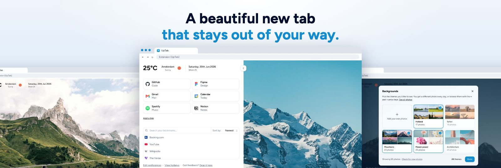
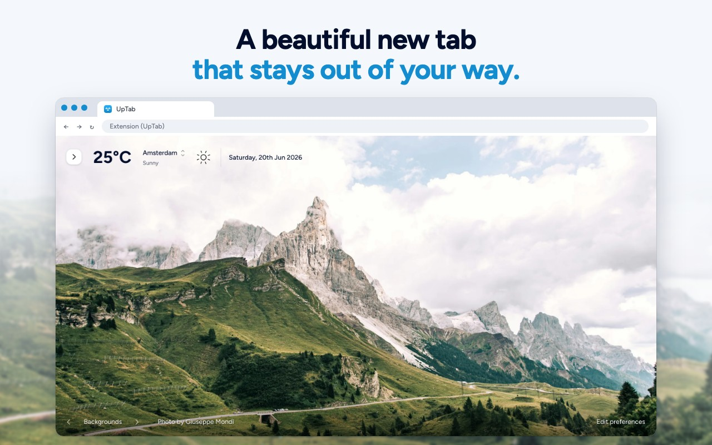
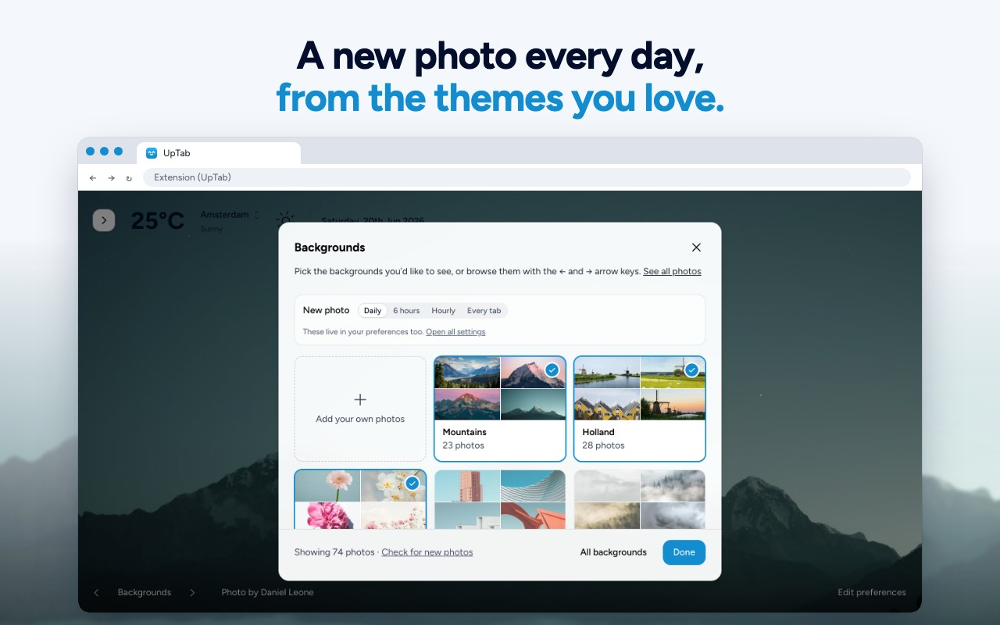
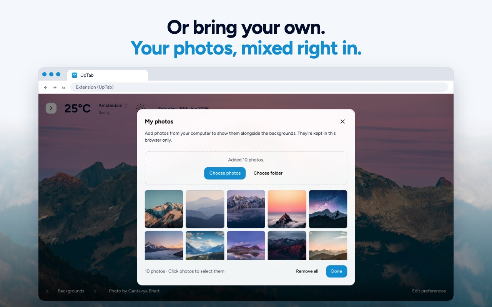
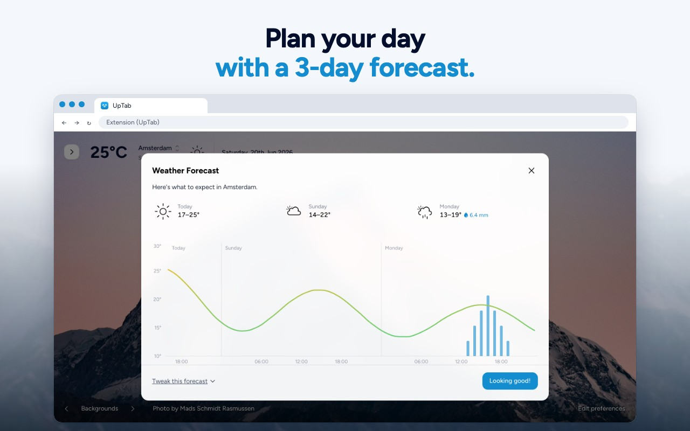
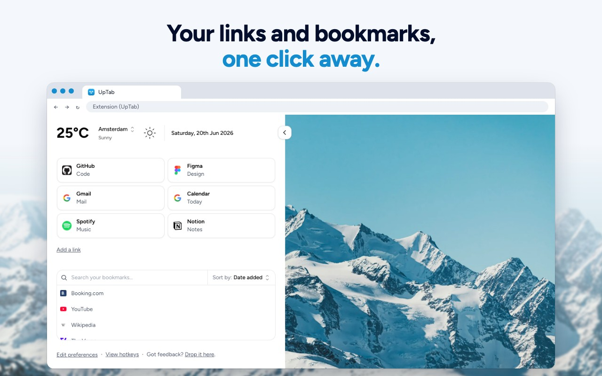

<h1>UpTab Cross-Browser Extension</h1>

What's UpTab?

A humble extension that super-charges your new tabs, adding quick access to bookmarks, shortlinks, weather information and of course beautiful photographs. Pick themes like mountains, safari and flowers, or add your own.

## Screenshots 🖼️ 

## Docs 📓 

1. [Setup](/docs/1-setup.md): install, run in Firefox or Chrome, test and lint.
2. [Architecture](/docs/2-architecture.md): how the extension and the website fit together, with diagrams.
3. [Releasing](/docs/3-releasing.md): the release checklist, the stores and the listing screenshots.

### For agents 🤖

- [CLAUDE.md](/CLAUDE.md): how agents should work in this repo.
- [docs/agents/](/docs/agents): the issue tracker, triage labels and domain docs.
- [.claude/skills/](/.claude/skills): `/changelog`, `/release-pr`, `/release-audit` and `/store-screenshots`.

## Credit 👏 

- UpTab's initial setup was scaffolded from [Vite Web Extension](https://github.com/JohnBra/vite-web-extension) by Jonathan Braat ([Licensed under MIT](LICENSE)).
