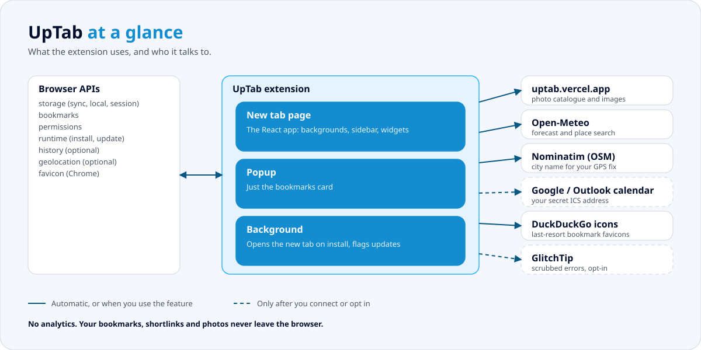
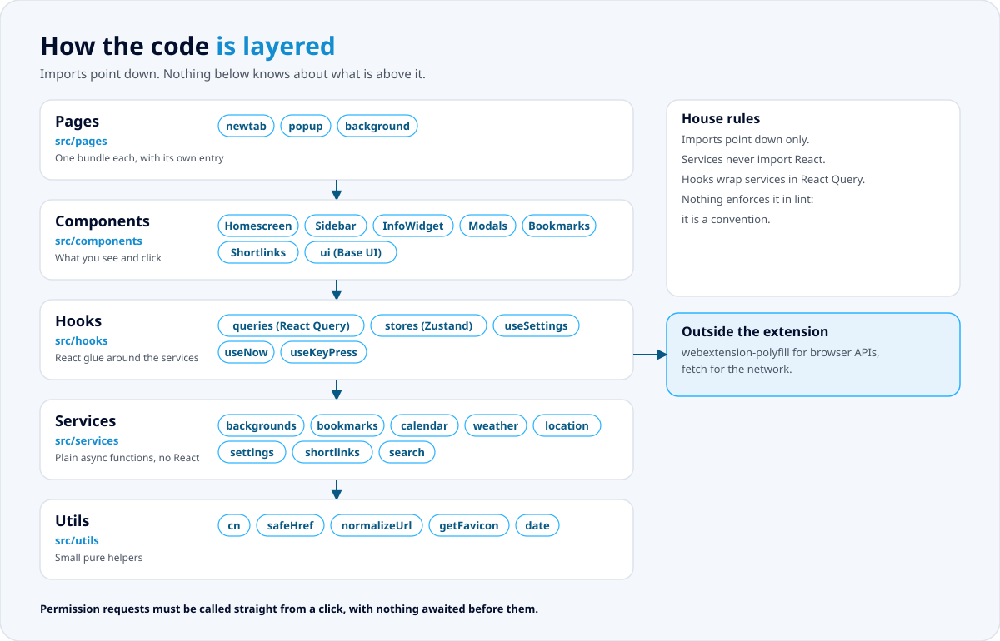
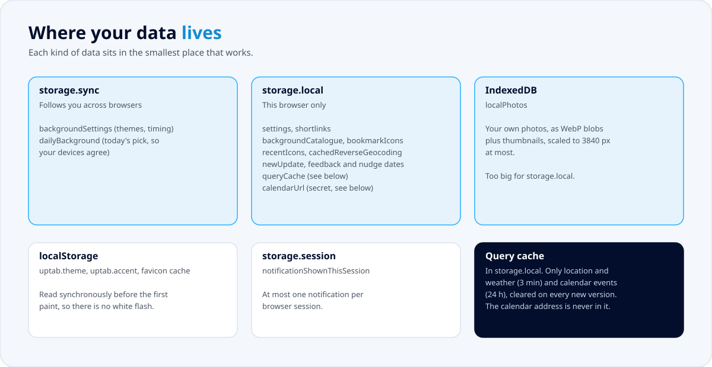
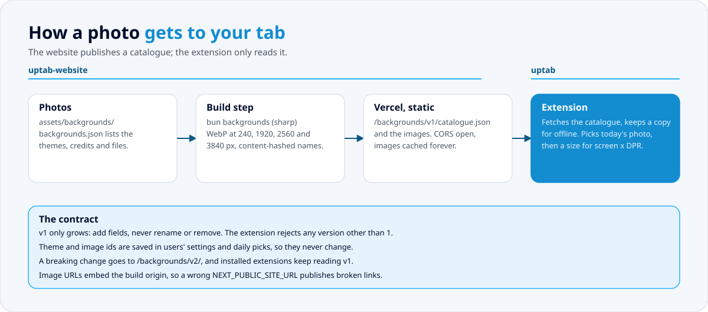
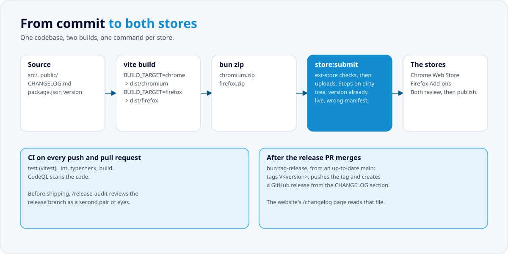

# Architecture 

UpTab is two repositories:

- **uptab** (this repo): the browser extension, built for Chrome (and other Chromium browsers) and Firefox from one codebase.
- **uptab-website**: a Next.js site on Vercel. It promotes the extension, serves its background photos, and hosts the privacy page, terms, changelog and feedback form.

The extension is local-first. It keeps your data in the browser and needs the website for one thing it can't work without: the catalogue of background photos.

 

## 1. The extension

### 1.1 Entry points

Vite builds three bundles from `src/pages/`:

| Page         | What it is                                                                                                      |
| ------------ | --------------------------------------------------------------------------------------------------------------- |
| `newtab`     | The app. Replaces the new tab page and renders `Homescreen`: background, sidebar, info widget and modals.       |
| `popup`      | The toolbar popup. Only the bookmarks card, without persisted queries.                                          |
| `background` | Does almost nothing. Opens the new tab on install and flags an update (`newUpdate`) so the app can announce it. |

On Chrome the background is a service worker (`index.ts`); on Firefox it is a background page (`index.html`). It has no alarms and no message handlers.

The new tab loads `public/theme-init.js` before React, so the saved theme is applied before the first paint.

### 1.2 Layers

Code in `src/` is layered, and imports point down:

- **Services** are plain async functions that wrap `webextension-polyfill` or `fetch`. They know nothing about React, so they are the easiest code to test.
- **Hooks** put services behind React Query (`hooks/queries`) and hold UI state in Zustand (`hooks/stores`: the open modal and the selected shortlink).
- **Components** render. Settings screens are wired up in `components/Modals/SettingsModal` (`settingsRegistry.ts`, `settingEntries*.ts`).
- **Utils** are small helpers.

This is a convention: nothing in ESLint enforces it. There are two known exceptions. `hooks/useBookmarkMutations.ts` imports a type from a component, and `utils/getFavicon.ts` uses `webextension-polyfill`.

#### An example: the weather widget

`WeatherWidget` calls `useLocationAndWeather`, which runs two queries:

1. `["location", "gps"]`: `getGeocodedLocation` gets a GPS fix (`navigator.geolocation`, rounded to two decimals) and asks Nominatim for the place name, which is cached in `storage.local`.
2. `["weather", { lat, lon, days }]`: `getWeather` asks Open-Meteo, and `mapWeather` shapes the response.

A saved location skips step 1.

### 1.3 Where data lives

Settings are split in two: `settings.backgrounds` goes to `storage.sync` so it follows you across browsers, and everything else stays in `storage.local`. `getSettings` merges the saved values over `defaultSettings` with `deepmerge`, and arrays from storage replace the default arrays. A new setting therefore needs a default and nothing else: existing users pick it up on their next load.

React Query caches API data, and `persistQueries.ts` saves part of that cache to `storage.local`:

- Only queries whose key starts with `location`, `weather` or `calendar` are saved, and only successful ones.
- Location and weather live for 3 minutes, calendar events for 24 hours.
- The cache's `buster` is the extension version, so an update starts with a clean cache.
- The calendar connection (the secret address) is excluded on purpose.

### 1.4 What it talks to

| Host                                                               | For                                             | When                                  |
| ------------------------------------------------------------------ | ----------------------------------------------- | ------------------------------------- |
| `uptab.vercel.app`                                                 | Photo catalogue and the images                  | Each new tab, at most hourly          |
| `api.open-meteo.com`                                               | Forecast, with rounded coordinates              | When a location is known              |
| `geocoding-api.open-meteo.com`                                     | Place search                                    | While you type a city                 |
| `nominatim.openstreetmap.org`                                      | City name for a GPS fix                         | After a GPS fix, if it changed        |
| `calendar.google.com`, `outlook.live.com`, `outlook.office365.com` | Your secret calendar (ICS) address              | Hourly, once you connect a calendar   |
| Bookmarked sites, then `icons.duckduckgo.com`                      | Favicons                                        | When a bookmark or shortlink is shown |
| GlitchTip                                                          | Error reports, scrubbed of URLs and coordinates | Only if you opt in                    |

Chrome reads favicons from its own cache (`/_favicon/`) first, which sends nothing out. The extension has no analytics.

### 1.5 Permissions

Required permissions disable the extension for everyone on update until they accept a prompt, so new capabilities are **optional** and asked for when first used.

| Permission                          | Why                                  | Kind                                                                                  |
| ----------------------------------- | ------------------------------------ | ------------------------------------------------------------------------------------- |
| `storage`, `unlimitedStorage`       | Settings, caches and your own photos | Required                                                                              |
| `bookmarks`                         | The bookmarks card and editing       | Required                                                                              |
| `favicon`                           | Chrome's favicon cache               | Required, Chrome only                                                                 |
| `history`                           | Sorting bookmarks by visits          | Optional                                                                              |
| `geolocation`                       | "Use my location"                    | Optional, in the manifest on Firefox                                                  |
| Calendar hosts (Google and Outlook) | Reading the calendar feed            | Optional, `optional_host_permissions` on Chrome and `optional_permissions` on Firefox |

A permission request must be made straight from the click handler: awaiting anything first makes the browser refuse it (see `useHistoryAccess`, `useLocationAccess` and `connectCalendar`).

### 1.6 Interface

- **Components**: [Base UI](https://base-ui.com/) with Phosphor icons. `components/ui` holds the shared primitives. Don't add Radix or Heroicons.
- **Styling**: Tailwind v4, with the font Figtree. Light and dark themes switch on `data-theme`, and the accent colour on `data-accent` (sky is the default). Both are saved in `localStorage` (`uptab.theme`, `uptab.accent`) so they apply before React runs.
- **Strings**: hard-coded English; there is no i18n layer.
- **Errors**: there are no React error boundaries. Errors are reported to GlitchTip only when the user has opted in.

 

## 2. The website

[uptab-website](https://github.com/AJGeel/uptab-website) is a Next.js app (React 19, Tailwind, Bun) deployed to Vercel at `uptab.vercel.app`.

| Route                            | What it is                                                                                               |
| -------------------------------- | -------------------------------------------------------------------------------------------------------- |
| `/`                              | The marketing page                                                                                       |
| `/backgrounds`                   | A gallery of the photos                                                                                  |
| `/backgrounds/v1/catalogue.json` | The catalogue the extension reads (static)                                                               |
| `/changelog`                     | Release notes, read from this repo's `CHANGELOG.md` through the GitHub API, so a release needs no deploy |
| `/feedback`                      | The feedback form the extension links to, with the version and browser in the query string               |
| `/privacy`, `/terms`             | Policy pages, linked from the extension's settings and the calendar connect dialog                       |

Feedback is stored in a database and emailed as a daily digest. The photo manager (`/adminland`) exists only under `next dev`.

### 2.1 Background photos

The photos and their credits live in the website repo (`assets/backgrounds/` and `backgrounds.json`). On every build, `bun backgrounds` resizes them to WebP and writes `catalogue.json`. Vercel serves it all as static files, so there is no separate image host.

In the extension, `services/backgrounds` does the rest:

- `getCatalogue` fetches the catalogue with a 5 second timeout and saves the raw JSON, which it falls back to when offline.
- `parseCatalogue` accepts only `version: 1` and ignores fields it doesn't know.
- `pickDailyImage` shuffles the images deterministically by date, so every device picks the same photo, and the pick is synced.
- `pickRendition` takes the smallest size that covers `screen.width × devicePixelRatio`.
- Photos you add yourself are stored in IndexedDB as theme `local` and merged in by `withLocalPhotos`.
- A bundled fallback photo (`public/images/fallback-background.webp`) covers a failed catalogue.

### 2.2 The contract between the two

Installed extensions can't be updated on the spot, so the website must keep serving what they already read:

- The catalogue under `/backgrounds/v1/` only grows. A breaking change goes to `/v2/`.
- Theme and image ids are saved in users' settings and daily picks. They never change.
- The extension hard-codes `uptab.vercel.app` and its paths (`/changelog`, `/privacy`, `/terms`, `/backgrounds`, `/feedback`).
- The `/changelog` page parses `CHANGELOG.md`, so changing that format changes the page.
- The `v` query parameter on `/feedback` is validated by the same pattern in both repos, which is duplicated, not shared.

When developing against a local website, set `VITE_CATALOGUE_URL` in `.env`. Production builds ignore it.

 

## 3. Build, test and release

- **Build**: `bun run build` runs Vite twice, with `BUILD_TARGET=chrome` into `dist/chromium` and `BUILD_TARGET=firefox` into `dist/firefox`. The `makeManifest` plugin writes the manifest from `src/manifest.ts` (so `public/manifest.json` is a build artifact), and `includeChangelog` copies `CHANGELOG.md` for the "What's new" window.
- **Test**: Vitest, with tests next to the code (`*.test.ts`), mostly for services and utils.
- **CI** runs test, lint, typecheck and build on every push and pull request, and CodeQL scans the code.
- **Release**: see [Releasing](/docs/2-releasing.md). `ext-store` submits to both stores and refuses to upload from a dirty tree, a version a store already has, or a manifest for the wrong browser. `bun tag-release` tags the merged release and creates the GitHub release. `/release-audit` reviews a release branch before it ships.

 

## 4. Good to know

- **Secrets stay local.** The calendar address is a secret link. It lives only in `storage.local` under `calendarUrl`: not in `storage.sync`, not in a query key, not in the persisted cache, and not in error reports.
- **Add settings with defaults.** Existing users get a new setting through `defaultSettings`. Removing one leaves its saved value behind, unused.
- **Update-proof additions.** Anything new that needs a browser permission is optional, and the feature must work without it.
- **The website is part of the API.** Moving the domain, or renaming catalogue ids or paths, breaks installed extensions that can't be updated.
